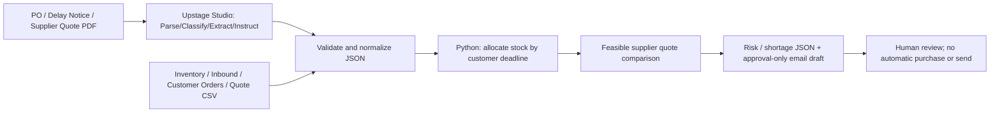

# System Architecture — LeadTime Guardian V1

## Roles and contracts
AI handles unstructured documents and explanations only. Python owns dates, quantities, capacity, monetary amounts. Target normalized extraction JSON includes `document_id,document_type,po_id,supplier_id,original_delivery,revised_delivery,items[],quote,warnings`. Engine input is a single `case_id`, `snapshot_date`, `inventory[]`, `inbound[]`, `orders[]`, `quotes[]`. Engine output is `schema_version,case_id,status,delays[],impacted_orders[],supplier_options[],uncovered_quantity,needs_review,review_flags,execution_status,external_action_taken`. All input dates ISO YYYY-MM-DD, quantities nonnegative integer EA, prices KRW decimal strings.

## Algorithm
For each SKU sort customer orders by due date then order ID. Add inbound batches with ETA <= customer's deadline. Allocate min(request, currently available) and never reuse allocated stock. Compute `delay_days=max(0,eta-original_eta)`. Each eligible quote must arrive by deadline; consume its total capacity across orders and recommend priced quantities. Shipping is charged once per used quote. The total remains a greedy draft estimate, not approved procurement or a global optimum. No business-calendar, BOM, quality losses, reserved-stock sync, ERP API, or global optimization.
Invalid PO/product/unit joins, duplicate IDs, missing dates, or bad amounts are not inferred: block and flag for review. Final purchase/email needs human approval (the MVP has no send action).

## Integration
외부 Studio 예측은 `loads_strict` → `documents_from_export` → `analyze_studio_documents`를 사용한다. 파싱/업무 검증 실패 시 공통 BLOCKED 응답에는 계산값이 없다. 원본·SHA-256·정규화 문서·별도 provenance를 보존한다. 계약·이전 규칙·실제 검증 범위는 [V6 인계](PYTHON_SAFETY_V6_HANDOFF.md)를 따른다.

Current runnable interface: `leadtime_guardian.engine.analyze_portfolio(payload)->dict`, `scripts/run_portfolio_demo.py`. A proposed `POST /v1/analyze` is **not implemented**. Studio Export Agent Config JSON is an external artifact, never synthesized. API key in local environment only. C modules for scenarios/evidence/optimizer can be added without changing the V1 calculation contract. Official: https://console.upstage.ai/docs/agents ; https://console.upstage.ai/ko/docs/studio/key-features
